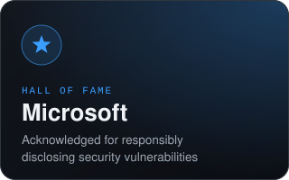
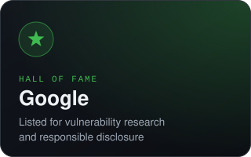
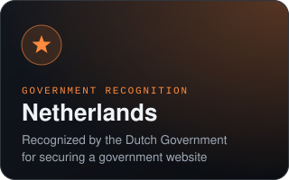
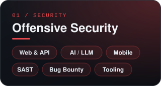
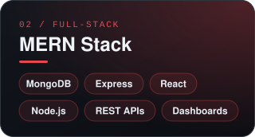
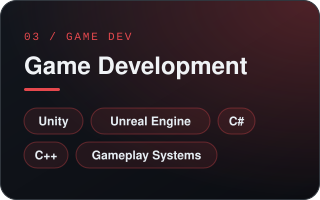
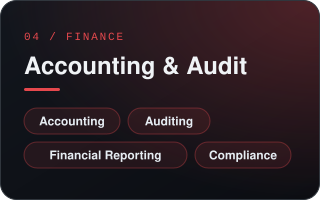

  
  
  
  

I'm a **security researcher and penetration tester** focused on offensive security, a **MERN stack developer** who ships full-stack products, and a **game developer** working in **Unity** and **Unreal Engine**. I'm also an **accountant and audit assistant**, so I'm as comfortable with ledgers as I am with logs. Currently building [Brahmastra Scanner](https://brahmastra.me/), which now red-teams **AI and LLM applications** alongside web, API, mobile and source code.

 

### Recognition

  
  
  

### What I do

  
  
  
  

### Featured project

<b>What Brahmastra covers</b>

 

| Module | Capabilities |
|---|---|
| **Web & API** | SQLi · XSS · SSRF · SSTI · RCE · IDOR · JWT & OAuth flaws · GraphQL · request smuggling · business-logic bugs |
| **AI / LLM Security** | OWASP LLM Top 10 · prompt injection & jailbreaks · system-prompt and data leakage · RAG poisoning · agent, tool-calling & MCP abuse |
| **Source Code (SAST)** | Multi-language injection chains · JavaScript taint analysis · secrets · insecure crypto |
| **Mobile** | Android/iOS instrumentation · SSL-pinning bypass · traffic interception |
| **Recon & CVE Intelligence** | Subdomain enumeration & takeover · live CVE correlation |
| **Verification** | Out-of-band confirmation · false-positive suppression · automated PoC generation |
| **AI Reporting** | Attack-chain discovery · context-aware findings · clean PDF reports |

### Toolbox

  

  
  
  
  
  
  
  
  
  
  

 

  India / UAE &nbsp;·&nbsp; open to security research, pentesting, full-stack and game dev collaboration &nbsp;·&nbsp; <a href="mailto:jishnupunnol@gmail.com">jishnupunnol@gmail.com</a>

